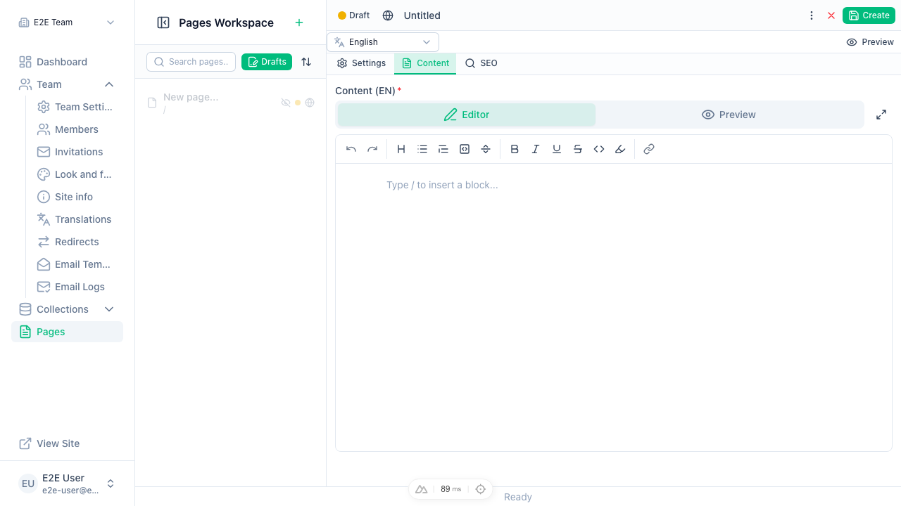

# #2324 — Content tab extracted (slice 3 of #1640)

Behaviour-preserving move: the editor's Content tab became `Editor/ContentTab.vue`
(+ `Editor/ContentBinderConfig.vue`). Evidence: the with-pages fixture after the change,
new page → Content tab → block editor with toolbar, language bar and the Editor/Preview switch.

Captured locally (`fixtures/with-pages`, e2e user, 1280×900) on 2026-10-19.
