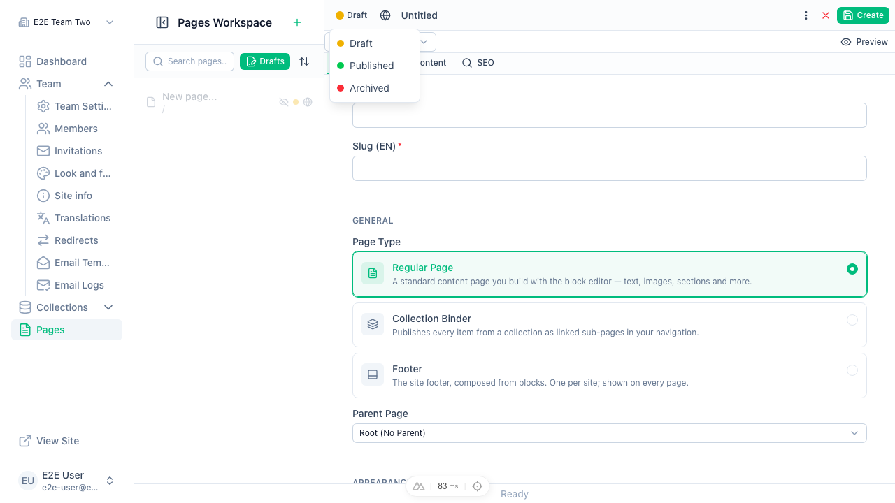
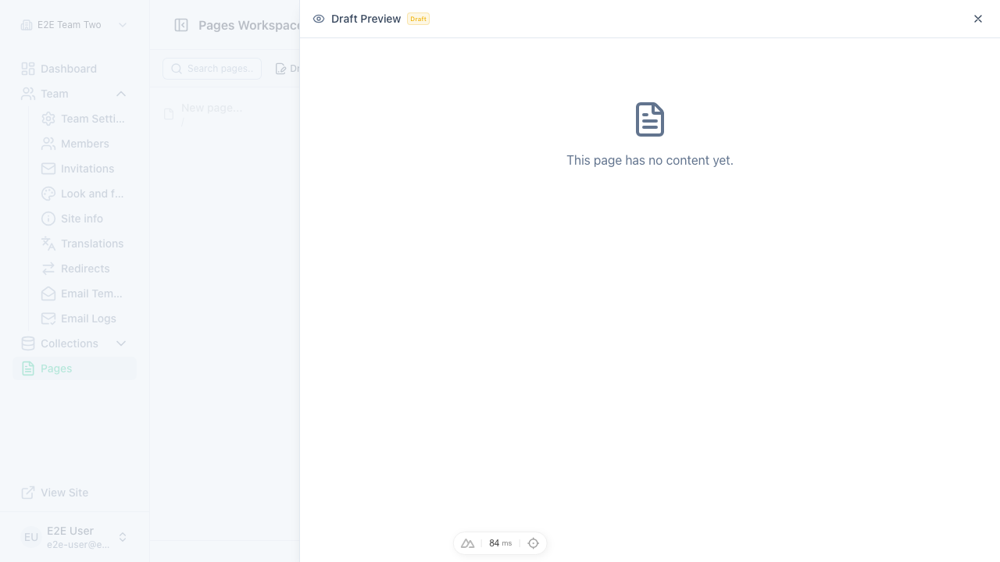

# #2325 + #2326 — preview slideover and settings/toolbar logic extracted (slices 4–5 of #1640)

Behaviour-preserving moves. Evidence from the with-pages fixture after both slices, driven with
the e2e user (1280×900, 2026-10-19):

- Settings tab (default tab of a new page): identity fields, page-type picker, parent page.

  

- Toolbar status menu, now owned by the toolbar: opens, and picking "Published" applies.

  

- Preview slideover, now its own component: opens with the draft badge.

  
